<div align="center">


### Website đặt đồ ăn cho chuỗi cửa hàng fast food nhiều chi nhánh

Khách đặt món mang đi hoặc giao hàng · Bán tại quầy (POS) · Quản lý vận hành chi nhánh · Admin điều hành toàn chuỗi


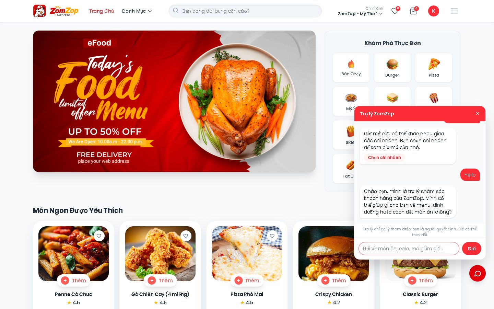

</div>

---

## Giới thiệu

ZomZop là đồ án chuyên ngành: website đặt đồ ăn cho **một thương hiệu fast food có nhiều chi nhánh** (không phải sàn nhiều nhà hàng). Mỗi chi nhánh có menu, giá, món bán chạy và món đề xuất riêng. Khách chọn chi nhánh gần mình rồi đặt món **mang đi** hoặc **giao hàng**.

Hệ thống phục vụ 5 nhóm người dùng:

| Vai trò | Làm được gì |
|---|---|
| **Khách hàng** | Đăng nhập thường hoặc Google/Facebook, xem menu theo chi nhánh, tìm món, chọn topping, giỏ hàng, mã giảm giá, đặt đơn (tiền mặt / VietQR), theo dõi, huỷ và đặt lại đơn, sổ địa chỉ, hộp thư thông báo, yêu thích, đánh giá, hỏi chatbot, gửi liên hệ |
| **Quản lý chi nhánh** | Duyệt đơn, xác nhận đã nhận tiền chuyển khoản, chỉnh menu / giá / tồn kho chi nhánh (nhập Excel được), gắn món Bán chạy, chọn món đề xuất, bán tại quầy (POS), nhân sự (nhập Excel được), ca làm và xếp lịch tuần, chấm công, bảng lương, báo cáo |
| **Nhân viên** | Bán tại quầy bằng **POS**, in hoá đơn, xem đơn mình đã bán, xem lịch làm và công của mình, chấm công khuôn mặt |
| **Bếp** | Màn hình bếp (đơn chờ nấu / đang nấu), xem lịch làm và công của mình, chấm công khuôn mặt |
| **Admin** | Chi nhánh, tài khoản quản lý, món và danh mục (nhập Excel được), topping, banner, ghim món nổi bật, mã giảm giá (gửi email cho khách), khách hàng, đơn hàng, chấm công và lương toàn chuỗi, báo cáo, cài đặt, từ khoá chatbot, tin nhắn liên hệ, nhật ký thao tác |

## Dành cho khách hàng

### Trang chủ và tìm món

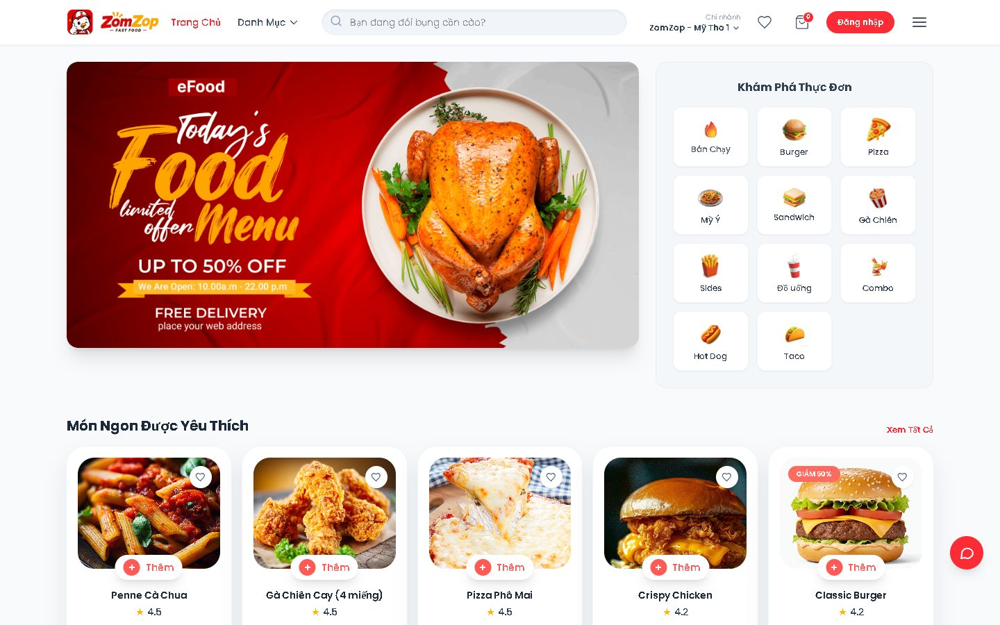

- Banner khuyến mãi, lưới **Khám Phá Thực Đơn**, mục **Món Ngon Được Yêu Thích** (admin ghim món), **Bán Chạy**, combo, món mới
- **Ưu Đãi Đặc Biệt Từ Đầu Bếp**: các món quản lý chi nhánh chọn, tự chuyển slide
- Mỗi thẻ món hiện **điểm sao** trung bình từ đánh giá của khách; giá và món đúng theo chi nhánh đang chọn
- **Form liên hệ** cuối trang: khách vãng lai cũng gửi được, tin nhắn chuyển tới trang admin

| Danh mục món | Món bán chạy của chi nhánh |
|---|---|
| 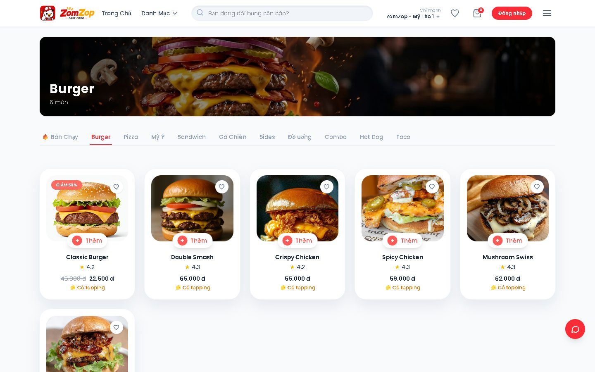 | 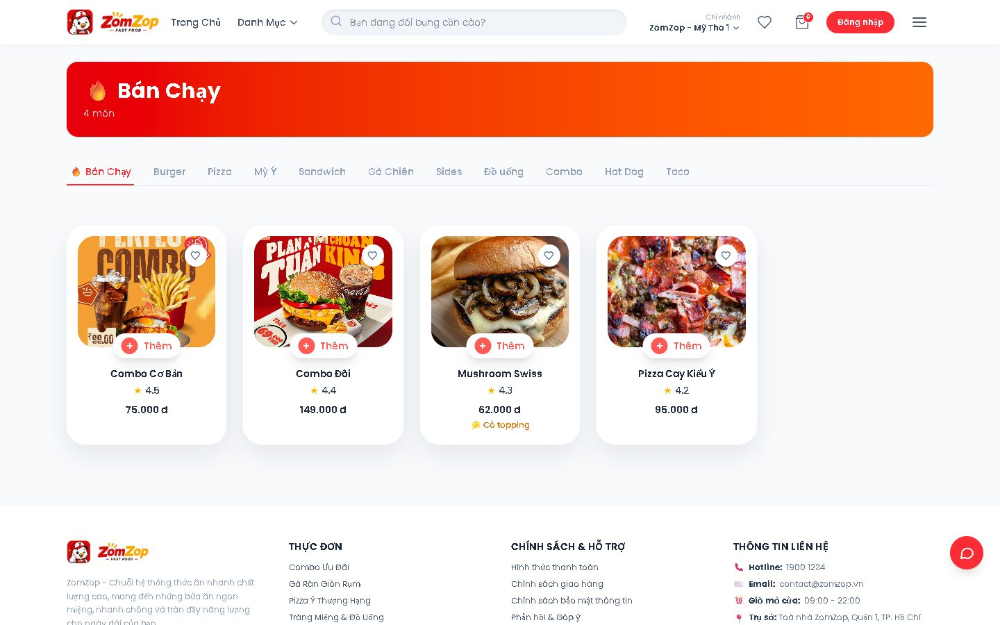 |
| Lọc theo danh mục, sắp xếp theo giá | Quản lý tự gắn tag Bán chạy cho từng chi nhánh |

| Tìm món ngay khi gõ | Chọn chi nhánh |
|---|---|
| 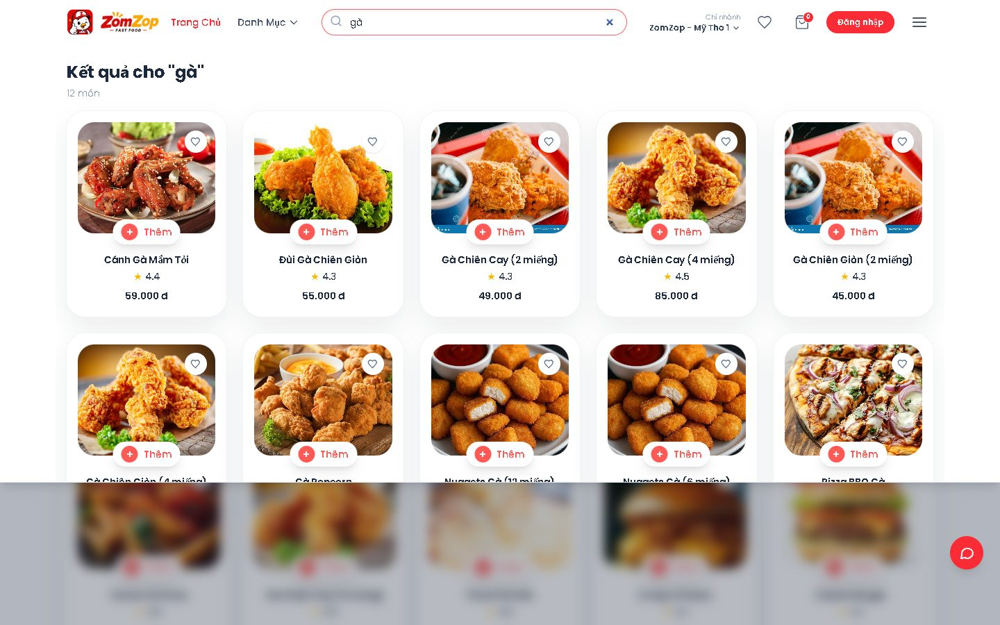 | 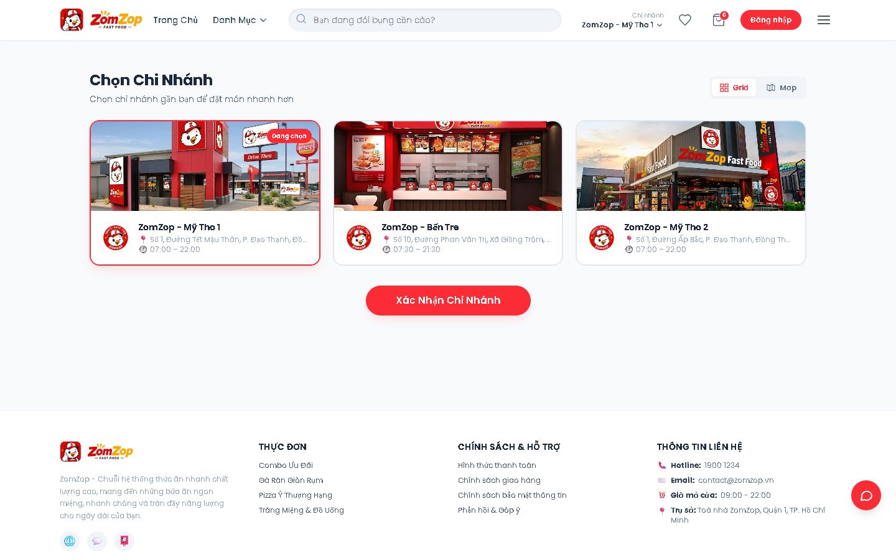 |
| Kết quả hiện ngay khi gõ, nền trang được làm mờ | Mỗi chi nhánh có menu và giá riêng, giỏ hàng tự làm mới khi đổi chi nhánh |

### Chọn món, giỏ hàng và đặt đơn

| Chọn topping theo số phần | Giỏ hàng |
|---|---|
| 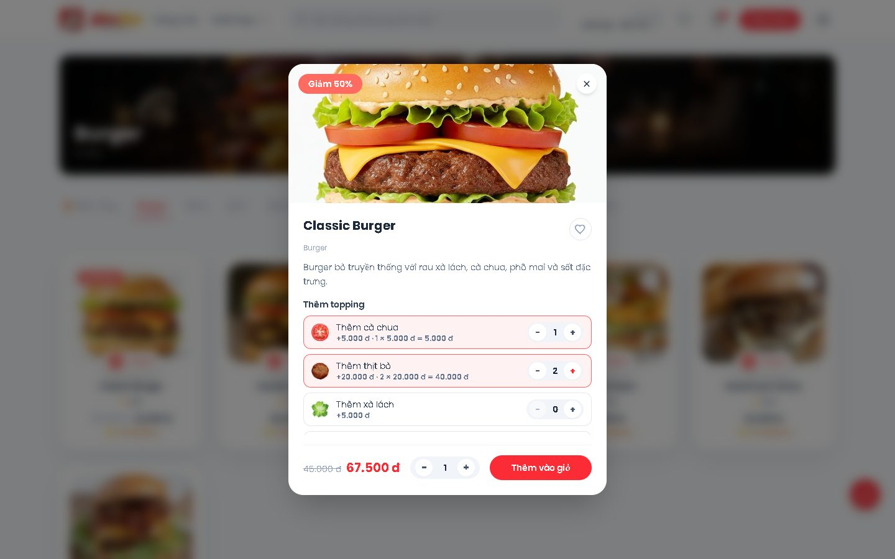 | 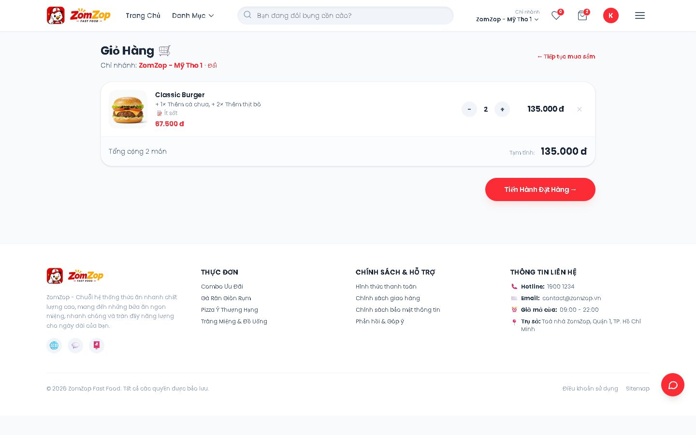 |
| Món burger thêm được topping, tối đa 5 phần mỗi loại, giá cộng ngay vào món | Ghi chú riêng từng món; giỏ được lưu theo tài khoản, đăng nhập lại vẫn còn |

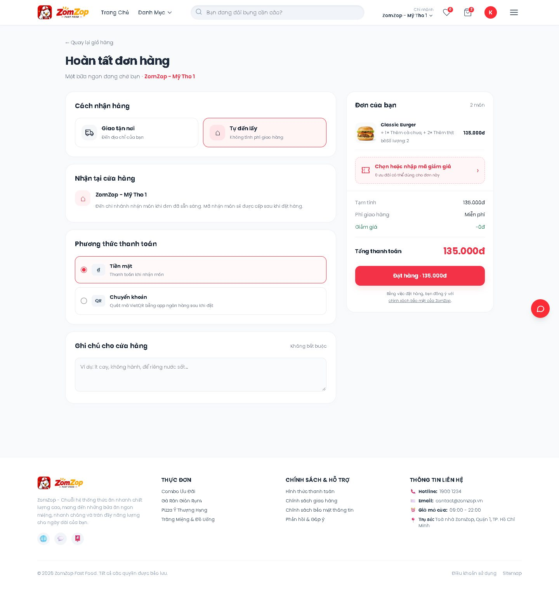

- Khách chưa đăng nhập vẫn thêm món vào giỏ được; chỉ đặt được số lượng còn trong **tồn kho** của chi nhánh
- Chọn **giao tận nơi** (tiêu chuẩn / hoả tốc, lưu nhiều **địa chỉ giao hàng**) hoặc **tự đến lấy**
- Áp mã giảm giá, thanh toán tiền mặt hoặc **chuyển khoản VietQR** (mã QR có sẵn số tiền và nội dung)
- Đơn lưu lại tên, giá và topping tại thời điểm đặt, sau này đổi giá cũng không lệch

### Sau khi đặt

| Đơn hàng của tôi | Hộp thư thông báo |
|---|---|
| 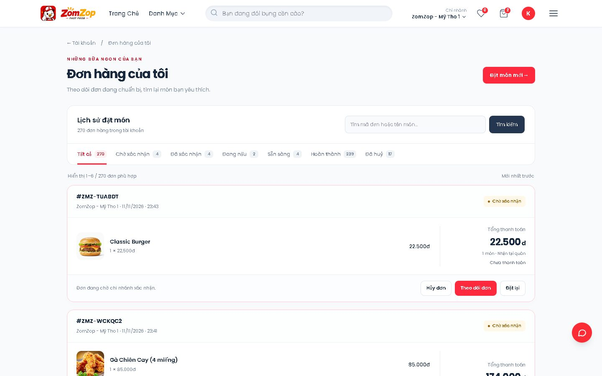 | 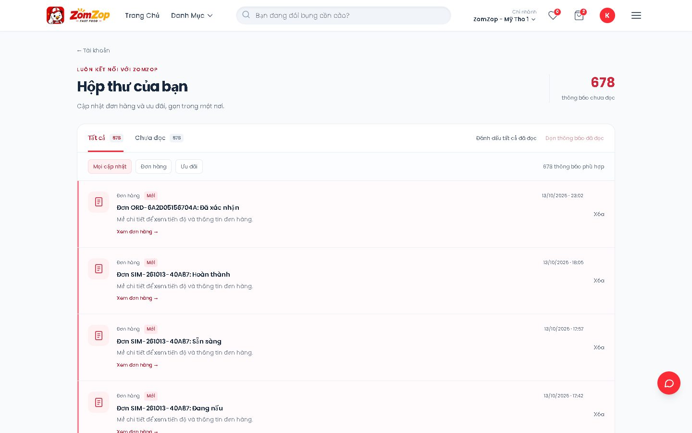 |
| Lọc theo trạng thái, theo dõi đơn, **tự huỷ đơn** kèm lý do khi đơn chưa được làm, **đặt lại** đơn cũ, đánh giá đơn đã hoàn thành | Cập nhật trạng thái đơn và mã giảm giá được tặng, đánh dấu đã đọc |

### Chatbot và giao diện điện thoại

<table>
<tr>
<td width="62%"></td>
<td width="38%">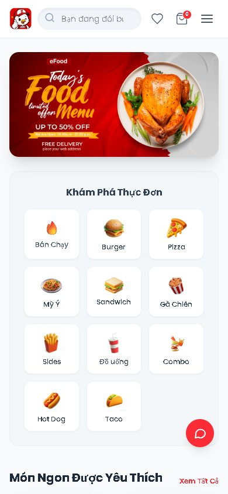</td>
</tr>
</table>

- Câu hỏi thường gặp (giờ mở cửa, chi nhánh, mã giảm giá, cách đặt món...) được trả lời ngay bằng **từ khoá** do admin soạn, kèm nút dẫn tới trang liên quan
- Câu hỏi khác do **Gemini** trả lời, dựa trên menu và giá thật của chi nhánh
- Bot chỉ **gợi ý khách quan**, để khách tự quyết định và luôn nhắc **giá có thể thay đổi**
- Giao diện khách hiển thị gọn trên điện thoại (ảnh bên phải)
- Đăng nhập thường hoặc bằng **Google / Facebook**

## Dành cho quản lý chi nhánh

### Tổng quan và đơn hàng

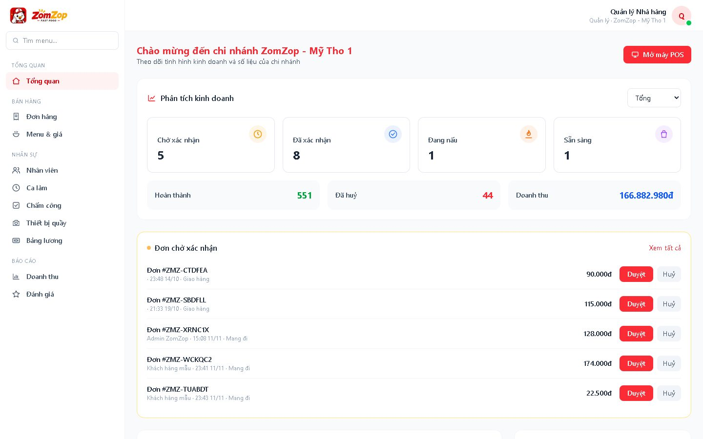

- **Tổng quan**: số đơn theo trạng thái và doanh thu (hôm nay / tháng này / tổng), biểu đồ đơn và doanh thu, duyệt hoặc huỷ nhanh đơn chờ xác nhận, nút mở **máy POS**
- **Ưu đãi đặc biệt từ đầu bếp**: chọn tối đa 10 món hiện trên trang chủ của chi nhánh

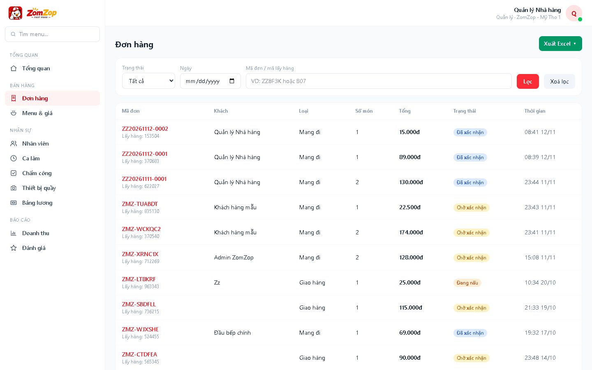

- **Đơn hàng**: đổi trạng thái theo đúng quy trình, xác nhận đã nhận tiền chuyển khoản, xuất Excel

### Menu và báo cáo

| Menu & giá chi nhánh | Báo cáo doanh thu |
|---|---|
| 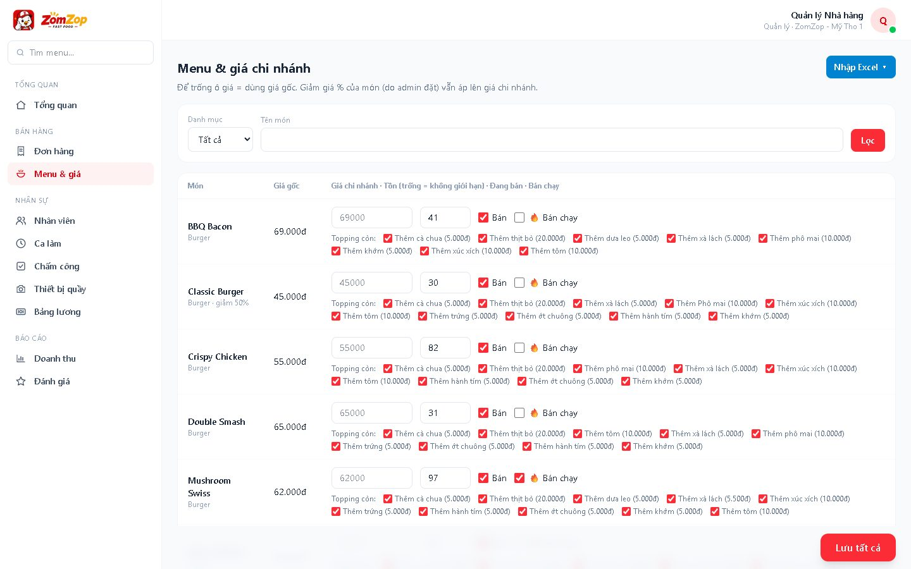 | 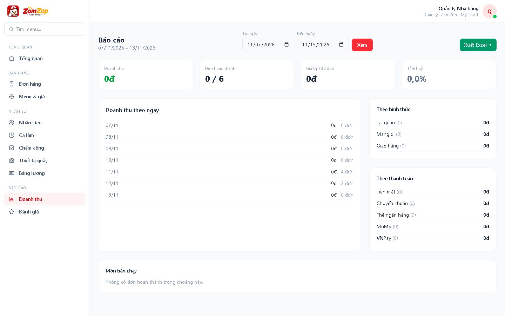 |
| Giá riêng, tồn kho, bật/tắt món, gắn Bán chạy, bật/tắt từng topping; **lưu cả bảng bằng một nút** hoặc **nhập Excel** | Theo ngày, hình thức, thanh toán, món bán chạy, **xuất Excel** |

### Nhân sự, ca làm, chấm công, lương

| Xếp lịch tuần | Lịch chấm công |
|---|---|
| 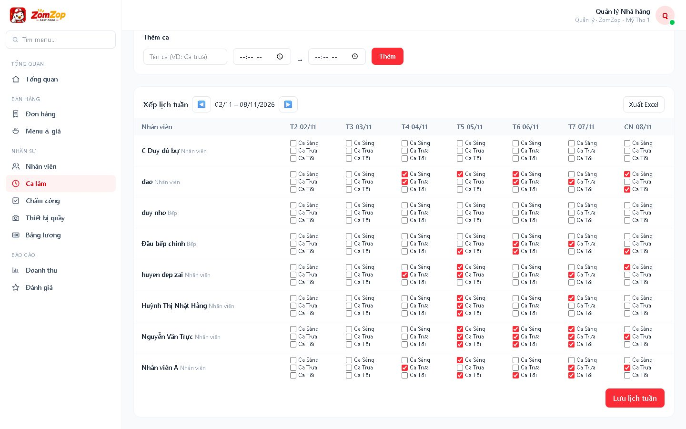 | 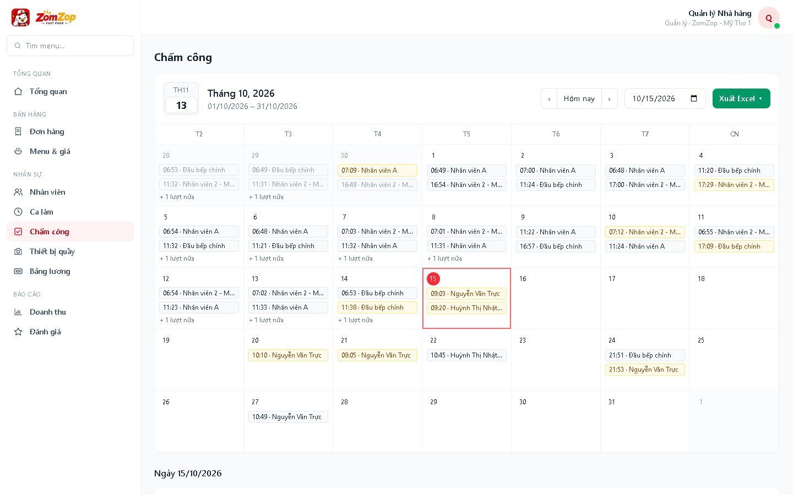 |
| Tạo ca; mỗi ô tick một hoặc nhiều ca, **Lưu lịch tuần**, xuất Excel | Lịch theo tháng, xem ảnh bằng chứng, xuất Excel theo ngày / tháng / năm |

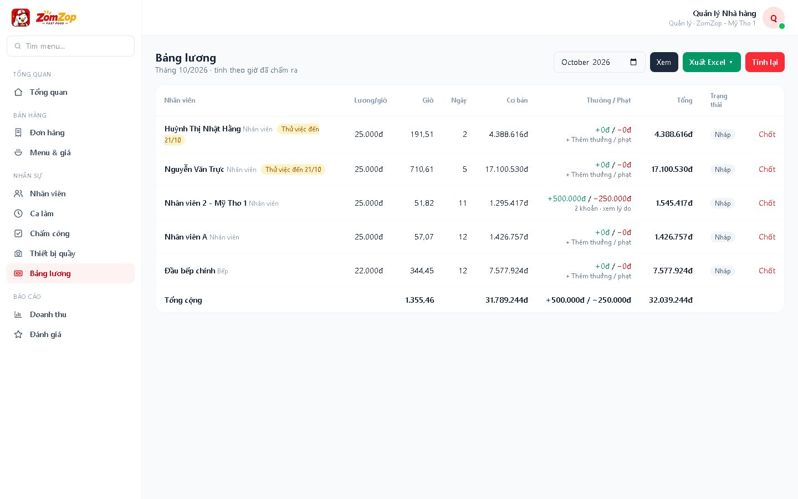

- **Nhân sự**: tạo, sửa, khoá tài khoản nhân viên và bếp (hoặc **nhập Excel** hàng loạt); đặt lương theo giờ
- **Chấm công bằng khuôn mặt**: quản lý đăng ký khuôn mặt nhân viên (tự chụp mẫu hoặc tải ảnh lên, không lưu ảnh đăng ký); máy tính bảng ở quầy nhận diện bằng face-api.js ngay trên trình duyệt, chỉ cần nhìn thẳng, hỏi lý do khi đi trễ hoặc về sớm, lưu ảnh bằng chứng có thời hạn. Chi tiết: [`docs/cham-cong-khuon-mat.md`](docs/cham-cong-khuon-mat.md)
- **Bảng lương**: tính theo giờ đã chấm (có lương thử việc), thưởng/phạt thành từng khoản có lý do, chốt và trả lương, xuất Excel
- **Đánh giá**: xem và trả lời đánh giá của khách

## Dành cho nhân viên và bếp

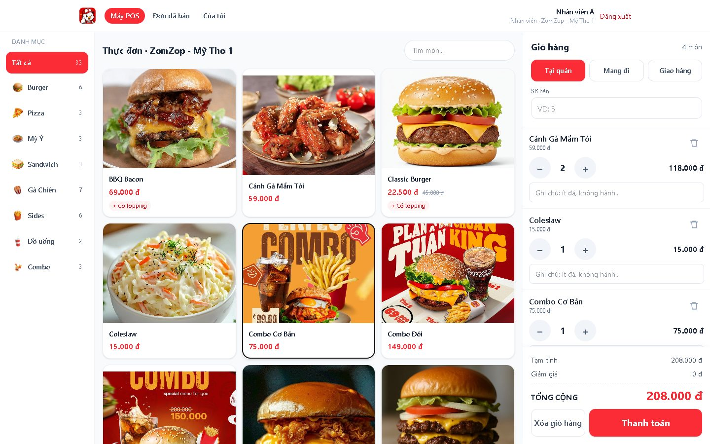

- **Máy POS** (trang mặc định của nhân viên sau khi đăng nhập; quản lý cũng dùng được): chọn món và topping, tại quán / mang đi / giao hàng, chốt đơn (giá do server tự tính), thanh toán tiền mặt hoặc VietQR, in hoá đơn; xem lại các đơn mình đã bán

| Trang "Của tôi" | Màn hình bếp |
|---|---|
| 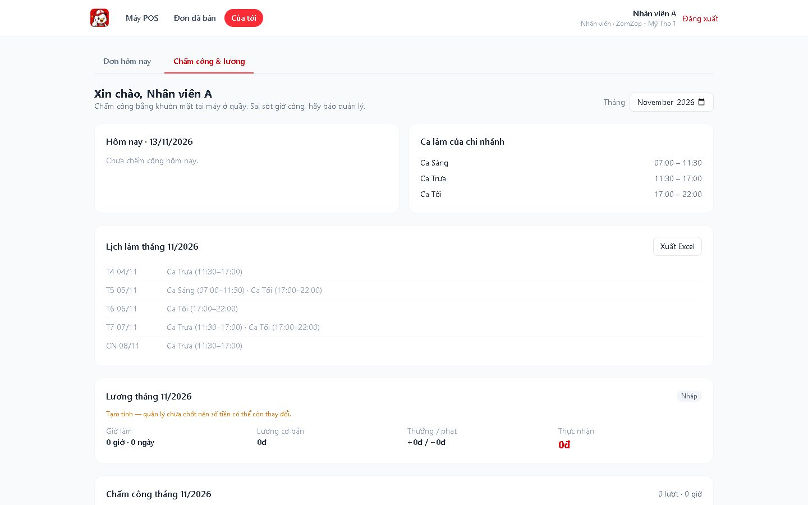 | 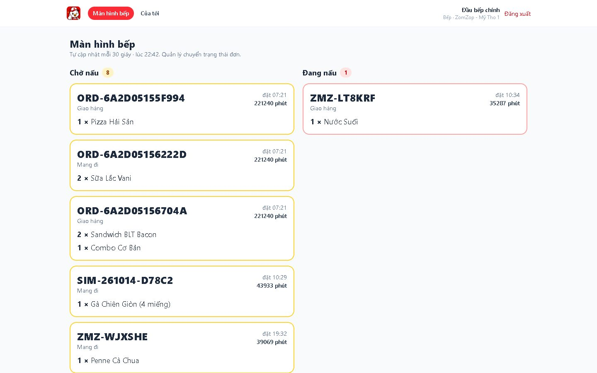 |
| Lịch làm theo tháng (xuất Excel), công đã chấm, lương tạm tính | Đơn chờ nấu / đang nấu, tự cập nhật mỗi 30 giây (chỉ xem, quản lý đổi trạng thái) |

## Dành cho admin

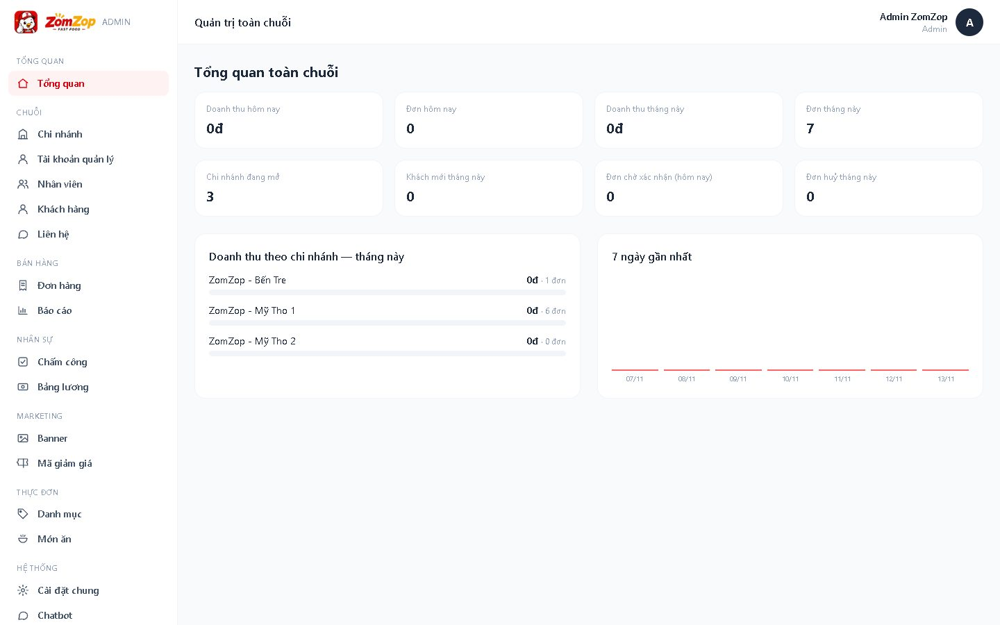

| Món ăn toàn chuỗi | Mã giảm giá |
|---|---|
| 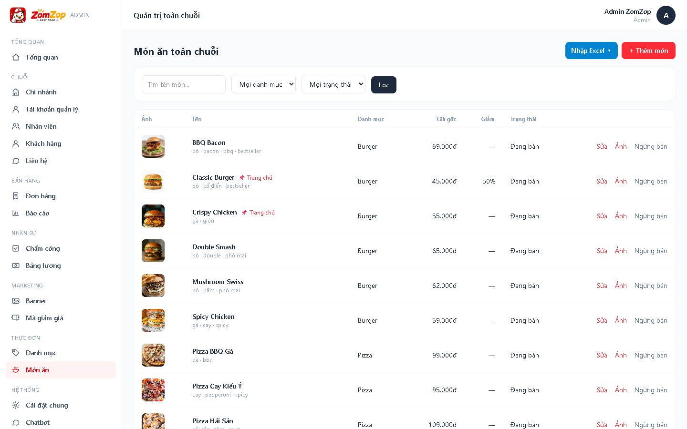 | 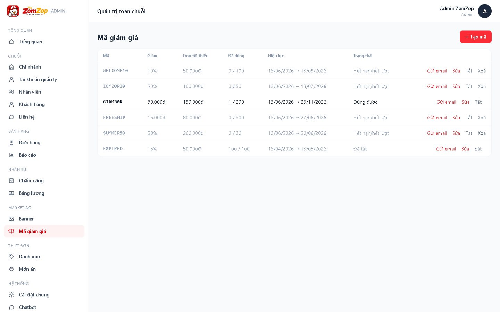 |
| Nhiều ảnh mỗi món, topping riêng từng món, **ghim món** lên trang chủ, **nhập Excel** từ file mẫu | Mã theo phạm vi, **gửi email** cho khách (có link huỷ nhận tin) |

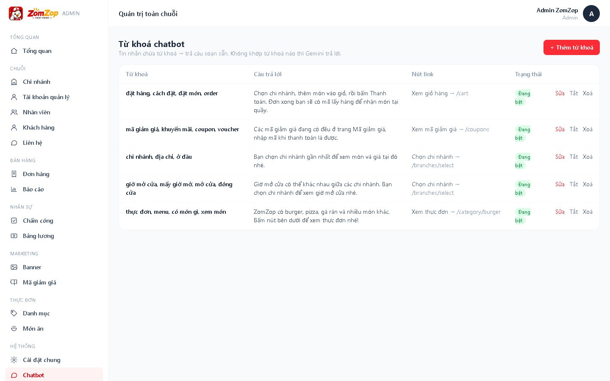

Ngoài ra: chi nhánh, tài khoản quản lý, nhân viên, khách hàng (khoá / mở tài khoản), đơn hàng, chấm công và bảng lương toàn chuỗi; báo cáo toàn chuỗi (xuất Excel); danh mục; banner trang chủ (tỉ lệ 2:1); cài đặt chung (thông tin liên hệ, phương thức thanh toán); từ khoá chatbot (ảnh trên); **tin nhắn liên hệ** từ trang chủ (đánh dấu đã xử lý); nhật ký thao tác.

## Công nghệ

| Phần | Công nghệ |
|---|---|
| Backend | Laravel 13, PHP 8.3 |
| Cơ sở dữ liệu | MySQL (session, cache, queue dùng driver database) |
| Đăng nhập mạng xã hội | Laravel Socialite (Google, Facebook) |
| Thanh toán chuyển khoản | VietQR (mã QR tạo từ thông tin ngân hàng trong `.env`) |
| Giao diện | Blade, Tailwind CSS 4, Vite 8 |
| Biểu đồ | ApexCharts |
| Slider | Swiper |
| Nhận diện khuôn mặt | @vladmandic/face-api |
| Nhập / xuất Excel | PhpSpreadsheet, OpenSpout |
| Chatbot | Google Gemini API |
| Kiểm thử | PHPUnit (370+ test, SQLite trong bộ nhớ) |

## Cài đặt

**Yêu cầu:** PHP 8.3+, Composer, Node.js và npm, MySQL (tạo sẵn database `zomzop`).

```bash
composer install
npm install

cp .env.example .env
php artisan key:generate
```

Sửa thông tin MySQL trong `.env`:

```env
DB_CONNECTION=mysql
DB_HOST=127.0.0.1
DB_PORT=3306
DB_DATABASE=zomzop
DB_USERNAME=root
DB_PASSWORD=
```

Muốn chatbot trả lời bằng Gemini thì thêm khoá API (bỏ trống thì bot chỉ trả lời theo từ khoá):

```env
GEMINI_API_KEY=khoa-cua-ban
GEMINI_MODEL=gemini-3.1-flash-lite
GEMINI_TIMEOUT=180
```

Thông tin tài khoản nhận chuyển khoản (VietQR) và đăng nhập Google/Facebook (bỏ trống thì bấm nút sẽ báo lỗi):

```env
BANK_ID=vcb
BANK_NAME=Vietcombank
BANK_ACCOUNT_NUMBER=
BANK_ACCOUNT_HOLDER=

GOOGLE_CLIENT_ID=
GOOGLE_CLIENT_SECRET=
FACEBOOK_CLIENT_ID=
FACEBOOK_CLIENT_SECRET=
```

URL trả về cần khai báo với Google/Facebook: `APP_URL/auth/google/callback` và `APP_URL/auth/facebook/callback`. Cách demo: [`docs/huong-dan-dang-nhap-fb-gg-khi-demo.md`](docs/huong-dan-dang-nhap-fb-gg-khi-demo.md).

Tạo bảng, nạp dữ liệu mẫu và chạy:

```bash
php artisan migrate --seed
npm run build        # hoặc: npm run dev (tự tải lại khi sửa giao diện)
php artisan serve    # mở http://127.0.0.1:8000
```

> Có thể chạy cùng lúc server, queue, log và Vite bằng một lệnh: `composer dev`.
> Email gửi mã giảm giá đi qua **queue**, cần có worker chạy (`composer dev` hoặc `php artisan queue:work`) thì mail mới đi.
> Ảnh chấm công quá hạn được xoá bằng `php artisan attendance:prune-photos` (scheduler chạy hằng ngày).
> Trang chấm công khuôn mặt cần camera, nên mở bằng `http://localhost:8000` (trình duyệt chỉ cho dùng camera trên localhost hoặc HTTPS).

### Tài khoản mẫu

Mật khẩu của mọi tài khoản là `12345678`.

| Vai trò | Mỹ Tho 1 | Bến Tre | Mỹ Tho 2 |
|---|---|---|---|
| Quản lý 1 | `manager@zomzop.com` | `ql1.bentre@zomzop.com` | `ql1.mytho2@zomzop.com` |
| Quản lý 2 | `ql2.mytho1@zomzop.com` | `ql2.bentre@zomzop.com` | `ql2.mytho2@zomzop.com` |
| Nhân viên | `staff@zomzop.com`, `nv2.mytho1@zomzop.com` | `nv1.bentre@…`, `nv2.bentre@…` | `nv1.mytho2@…`, `nv2.mytho2@…` |
| Bếp | `kitchen@zomzop.com` | `bep.bentre@zomzop.com` | `bep.mytho2@zomzop.com` |

Ngoài ra có `admin@zomzop.com` (admin) và `customer@zomzop.com` (khách). Mỗi quản lý chỉ thấy và thao tác được dữ liệu chi nhánh của mình.

### Đã có database, vừa `git pull` code mới

```bash
composer install && npm install && npm run build
php artisan migrate                                 # cập nhật cấu trúc bảng, không mất dữ liệu
php artisan db:seed --class=UserSeeder              # thêm tài khoản mẫu còn thiếu
php artisan db:seed --class=ChatbotKeywordSeeder    # từ khoá chatbot mặc định
php artisan db:seed --class=MenuItemToppingSeeder   # topping mẫu cho món burger
php artisan db:seed --class=DemoRatingSeeder        # (tuỳ chọn) đánh giá sao, món Bán chạy, món đề xuất để demo
php artisan db:seed --class=DemoActivitySeeder      # (tuỳ chọn) chấm công và đơn hàng 60 ngày gần nhất
```

Các seeder trên chạy lại bao nhiêu lần cũng được. Hướng dẫn đầy đủ và cách tránh xung đột: [`docs/huong-dan-cap-nhat-code-cho-nhom.md`](docs/huong-dan-cap-nhat-code-cho-nhom.md).
Làm lại toàn bộ dữ liệu mẫu từ đầu: `php artisan migrate:fresh --seed` (**xoá sạch** dữ liệu đang có).

Thêm quản lý cho một chi nhánh bằng dòng lệnh:

```bash
php artisan zomzop:manager "Bến Tre" ten.moi@zomzop.com --name="Trần Văn A"
# Bỏ --password thì hệ thống tự tạo mật khẩu ngẫu nhiên và in ra màn hình
```

### Chạy test

```bash
php artisan test
```

## Cấu trúc thư mục chính

```
app/
├── Http/Controllers/        # trang khách, KioskController; Auth/, Manager/, Admin/, Staff/ (POS, bếp)
├── Models/                  # User, Branch, MenuItem, BranchMenuItem, Order, Review, ...
├── Services/                # BranchMenu, OrderStatusService, CustomerInbox, FaceMatcher, FacePunch,
│                            # BranchPayroll, BranchReport, Chatbot, CouponService, ...
└── Support/                 # ExcelReport, ExcelImport, SavedCart, Shipping, PaymentMethods, ...
config/zomzop.php            # phí ship, danh mục có topping, số phần topping tối đa
database/
├── migrations/
└── seeders/                 # dữ liệu mẫu: 3 chi nhánh, 8 danh mục, 39 món, đơn, đánh giá...
resources/
├── views/                   # layouts (app, manager, admin), trang khách, manager/, admin/, kiosk/
└── js/                      # chatbot, tìm kiếm, dashboard, chấm công khuôn mặt
routes/                      # web.php (khách), manager.php, admin.php, staff.php (POS, bếp), kiosk.php
docs/                        # hướng dẫn cho nhóm, tài liệu chấm công, ERD, kiến trúc, ảnh chụp màn hình
```

## Ghi chú kỹ thuật

- **Món & giá theo chi nhánh** (`App\Services\BranchMenu`): giá chi nhánh thay cho giá gốc, phần trăm giảm giá của món vẫn được áp lên; chi nhánh tắt món hoặc hết tồn kho thì khách không đặt được. Dùng chung cho trang khách, quản lý và POS.
- **Topping**: chỉ món thuộc danh mục trong `config('zomzop.topping_categories')` mới có topping; dòng giỏ và `order_items.toppings` lưu bản chụp `[{id, name, price, quantity}]`.
- **Trạng thái đơn** chỉ đổi qua `OrderStatusService` (máy trạng thái, ghi lịch sử vào `order_histories`). Đơn có `channel` là `online` (khách đặt) hoặc `pos` (bán tại quầy).
- **Điểm sao của món** là trung bình đánh giá của các đơn có món đó (đánh giá được chấm theo đơn).
- Giỏ hàng lưu trong **session** (khách vãng lai cũng dùng được), khi đã đăng nhập thì được chép sang cột `users.cart`.
- `order_items` lưu **tên, giá và topping tại thời điểm đặt**.
- **Máy chấm công** (`/kiosk`) xác thực bằng token thiết bị do quản lý cấp, không dùng phiên đăng nhập.
- `User`, `Branch`, `MenuItem` dùng **SoftDeletes**.
