<div align="center">


### Website đặt đồ ăn cho chuỗi cửa hàng fast food nhiều chi nhánh

Khách đặt món mang đi hoặc giao hàng · Quản lý vận hành chi nhánh · Admin điều hành toàn chuỗi


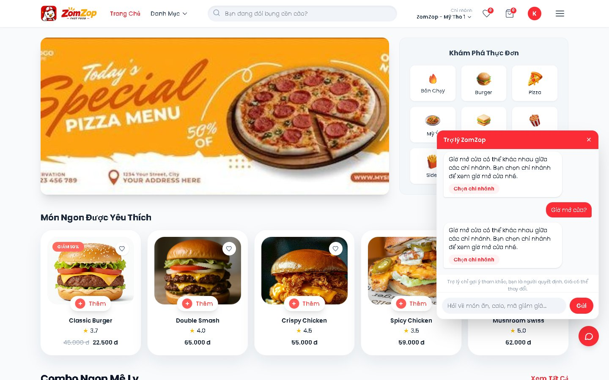

</div>

---

## Giới thiệu

ZomZop là đồ án chuyên ngành: website đặt đồ ăn cho **một thương hiệu fast food có nhiều chi nhánh** (không phải sàn nhiều nhà hàng). Mỗi chi nhánh có menu, giá, món bán chạy và món đề xuất riêng. Khách chọn chi nhánh gần mình rồi đặt món **mang đi** hoặc **giao hàng**.

Hệ thống phục vụ 5 nhóm người dùng:

| Vai trò | Làm được gì |
|---|---|
| **Khách hàng** | Xem menu theo chi nhánh, tìm món, giỏ hàng, mã giảm giá, đặt và theo dõi đơn, yêu thích, đánh giá, hỏi chatbot |
| **Quản lý chi nhánh** | Duyệt đơn, chỉnh menu và giá chi nhánh, gắn món Bán chạy, chọn món đề xuất, nhân sự, ca làm, chấm công, bảng lương, báo cáo |
| **Nhân viên / Bếp** | Chấm công bằng khuôn mặt tại máy ở quầy |
| **Admin** | Chi nhánh, tài khoản quản lý, món và danh mục, banner, mã giảm giá, cài đặt, từ khoá chatbot, nhật ký thao tác |

## Dành cho khách hàng

<table>
<tr>
<td width="50%">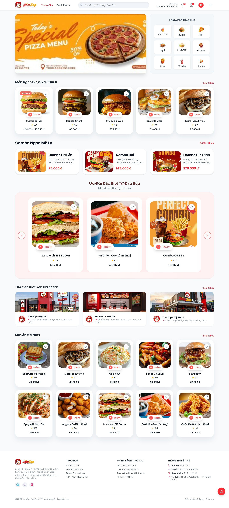</td>
<td width="50%">

**Trang chủ theo chi nhánh**

- Banner khuyến mãi, lối tắt danh mục và mục **Bán Chạy**
- Món được yêu thích, combo, món mới
- **Ưu Đãi Đặc Biệt Từ Đầu Bếp**: các món quản lý chi nhánh chọn, tự chuyển slide
- Mỗi thẻ món hiện **điểm sao** trung bình từ đánh giá của khách
- Giá và món hiển thị đúng theo chi nhánh khách đã chọn

</td>
</tr>
</table>

| Danh mục món | Món bán chạy của chi nhánh |
|---|---|
| 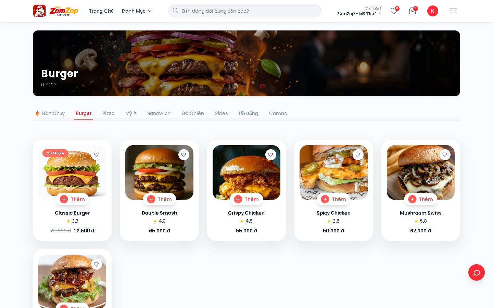 | 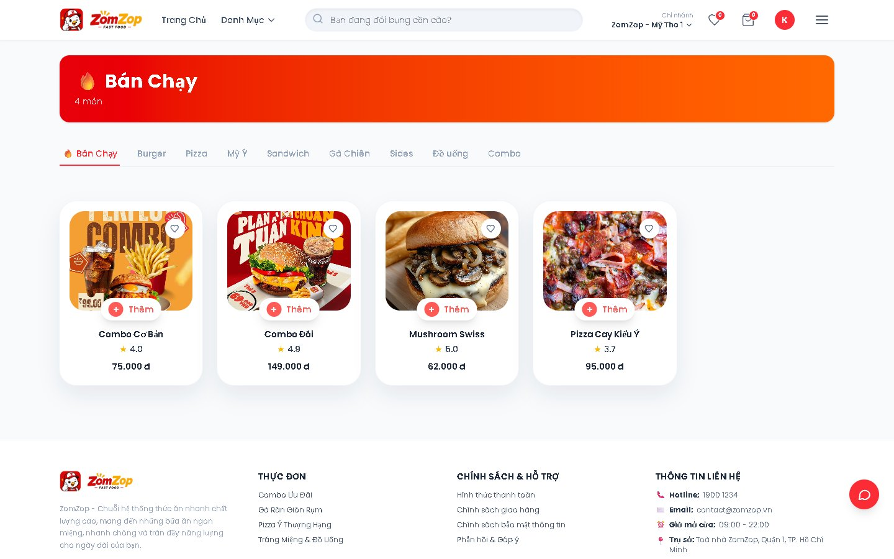 |
| Lọc theo danh mục, sắp xếp theo giá | Quản lý tự gắn tag Bán chạy cho từng chi nhánh |

| Tìm món ngay khi gõ | Chọn chi nhánh |
|---|---|
| 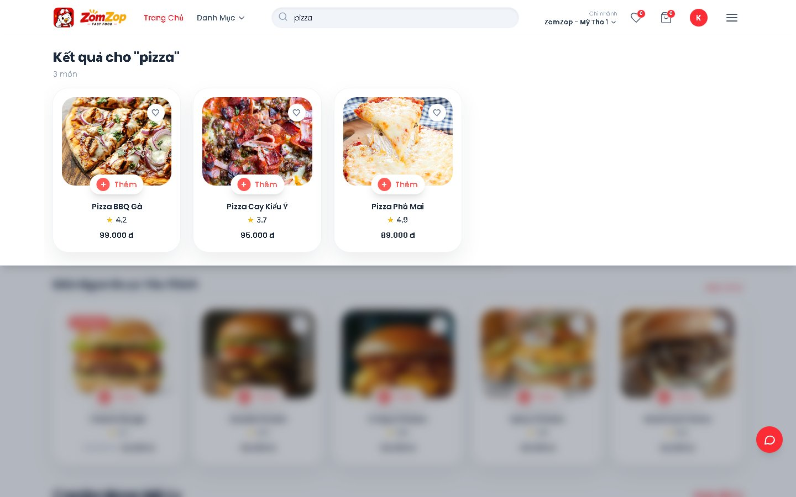 | 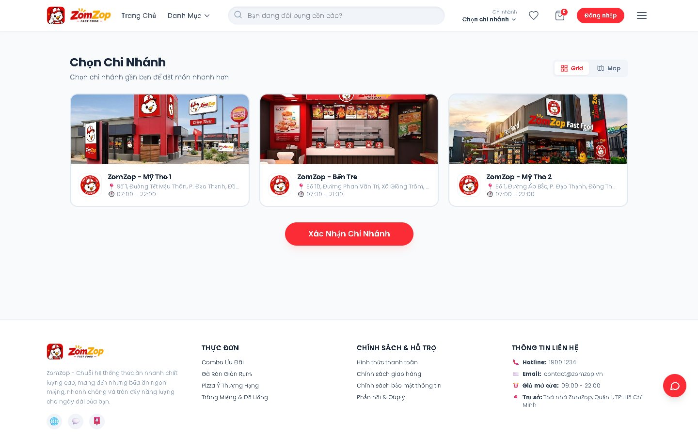 |
| Kết quả hiện ngay khi gõ, nền trang được làm mờ | Mỗi chi nhánh có menu và giá riêng, giỏ hàng tự làm mới khi đổi chi nhánh |

<table>
<tr>
<td width="30%">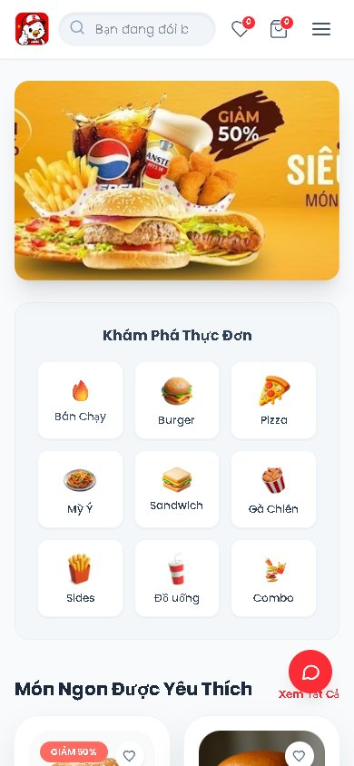</td>
<td>

**Trợ lý chatbot**

- Câu hỏi thường gặp (giờ mở cửa, chi nhánh, mã giảm giá, cách đặt món...) được trả lời ngay bằng **từ khoá** do admin soạn, kèm nút dẫn tới trang liên quan
- Câu hỏi khác do **Gemini** trả lời, dựa trên menu và giá thật của chi nhánh
- Bot chỉ **gợi ý khách quan**, để khách tự quyết định và luôn nhắc **giá có thể thay đổi**

**Giỏ hàng và đặt món**

- Khách chưa đăng nhập vẫn thêm món được, ghi chú riêng cho từng món
- Áp mã giảm giá, chọn mang đi hoặc giao hàng, chọn phương thức thanh toán
- Đơn lưu lại tên và giá món tại thời điểm đặt, sau này đổi giá cũng không lệch

**Giao diện điện thoại**: hiển thị gọn trên màn hình nhỏ (ảnh bên trái).

</td>
</tr>
</table>

## Dành cho quản lý chi nhánh

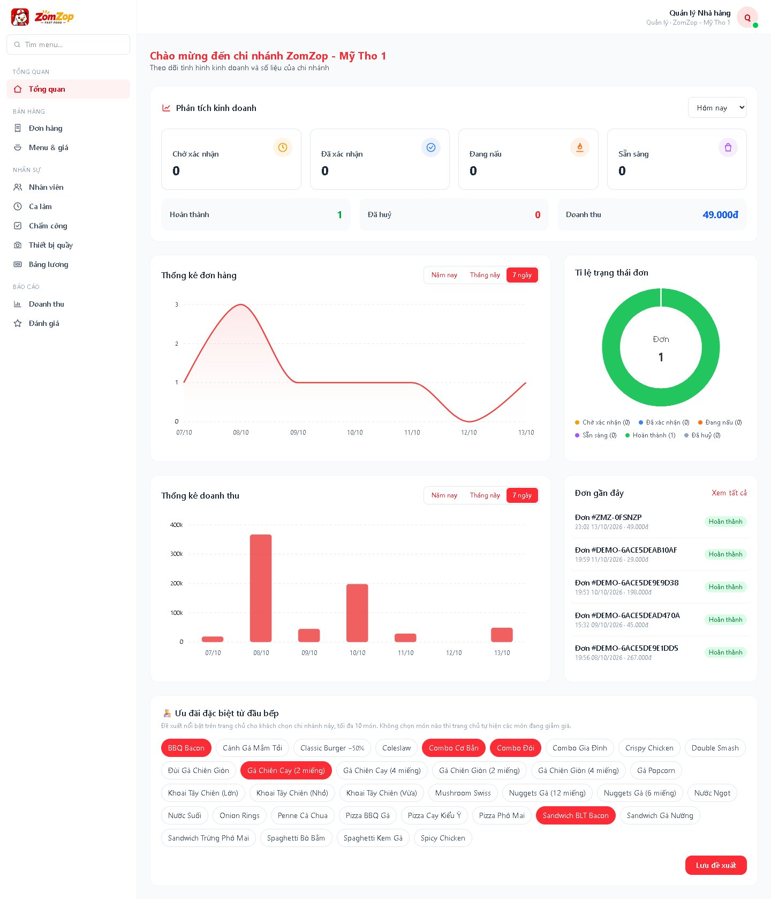

- **Tổng quan**: số đơn theo trạng thái và doanh thu (mặc định hôm nay), biểu đồ đơn và doanh thu (mặc định 7 ngày), duyệt hoặc huỷ nhanh đơn chờ xác nhận
- **Ưu đãi đặc biệt từ đầu bếp**: chọn tối đa 10 món hiện trên trang chủ của chi nhánh

| Menu & giá chi nhánh | Báo cáo doanh thu |
|---|---|
| 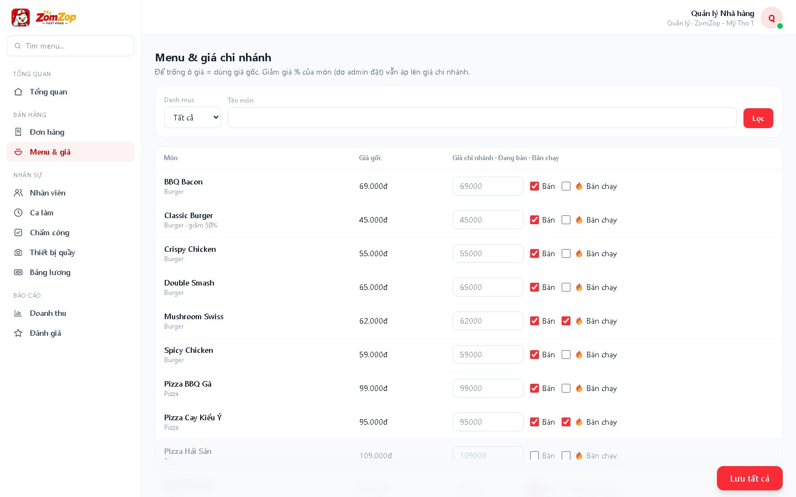 | 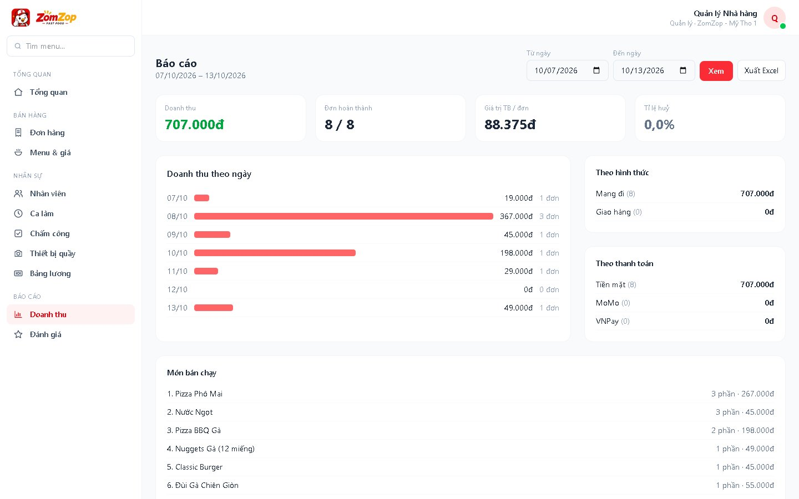 |
| Giá riêng, bật/tắt món, gắn Bán chạy, **lưu cả bảng bằng một nút** | Theo ngày, hình thức, thanh toán, món bán chạy, **xuất Excel** |

Ngoài ra còn có:

- **Nhân sự**: tạo, sửa, khoá tài khoản nhân viên và bếp; đặt lương theo giờ; quản lý ca làm
- **Chấm công bằng khuôn mặt**: máy tính bảng ở quầy nhận diện bằng face-api.js ngay trên trình duyệt, có kiểm tra người thật (chớp mắt, quay đầu), hỏi lý do khi đi trễ hoặc về sớm. Chi tiết: [`docs/cham-cong-khuon-mat.md`](docs/cham-cong-khuon-mat.md)
- **Bảng lương**: tính theo giờ đã chấm (có lương thử việc), thưởng/phạt, chốt lương, xuất Excel
- **Đánh giá**: xem và trả lời đánh giá của khách

## Dành cho admin

| Tổng quan toàn chuỗi | Từ khoá chatbot |
|---|---|
| 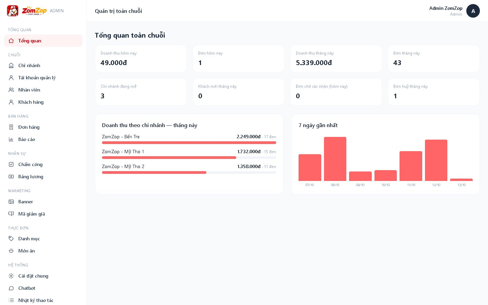 | 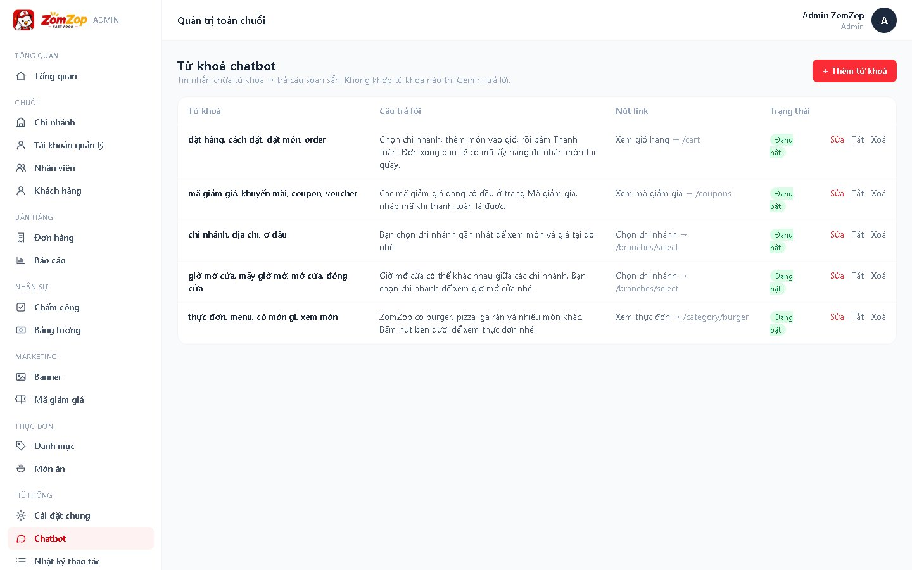 |

Quản lý chi nhánh, tài khoản quản lý, nhân viên, khách hàng, đơn hàng, chấm công và bảng lương toàn chuỗi; danh mục và món ăn (nhiều ảnh mỗi món); banner trang chủ; mã giảm giá (gửi thông báo cho khách); cài đặt chung (thông tin liên hệ, phương thức thanh toán); từ khoá chatbot; nhật ký thao tác.

## Công nghệ

| Phần | Công nghệ |
|---|---|
| Backend | Laravel 13, PHP 8.3 |
| Cơ sở dữ liệu | MySQL (session, cache, queue dùng driver database) |
| Giao diện | Blade, Tailwind CSS 4, Vite 8 |
| Biểu đồ | ApexCharts |
| Slider | Swiper |
| Nhận diện khuôn mặt | @vladmandic/face-api |
| Xuất Excel | OpenSpout |
| Chatbot | Google Gemini API |
| Kiểm thử | PHPUnit (300+ test, SQLite trong bộ nhớ) |

## Cài đặt

**Yêu cầu:** PHP 8.3+, Composer, Node.js và npm, MySQL (tạo sẵn database `zomzop`).

```bash
composer install
npm install

cp .env.example .env
php artisan key:generate
```

Sửa thông tin MySQL trong `.env`:

```env
DB_CONNECTION=mysql
DB_HOST=127.0.0.1
DB_PORT=3306
DB_DATABASE=zomzop
DB_USERNAME=root
DB_PASSWORD=
```

Muốn chatbot trả lời bằng Gemini thì thêm khoá API (bỏ trống thì bot chỉ trả lời theo từ khoá):

```env
GEMINI_API_KEY=khoa-cua-ban
GEMINI_MODEL=gemini-3.1-flash-lite
GEMINI_TIMEOUT=180
```

Tạo bảng, nạp dữ liệu mẫu và chạy:

```bash
php artisan migrate --seed
npm run build        # hoặc: npm run dev (tự tải lại khi sửa giao diện)
php artisan serve    # mở http://127.0.0.1:8000
```

> Có thể chạy cùng lúc server, queue, log và Vite bằng một lệnh: `composer dev`.
> Trang chấm công khuôn mặt cần camera, nên mở bằng `http://localhost:8000` (trình duyệt chỉ cho dùng camera trên localhost hoặc HTTPS).

### Tài khoản mẫu

Mật khẩu của mọi tài khoản là `12345678`.

| Vai trò | Mỹ Tho 1 | Bến Tre | Mỹ Tho 2 |
|---|---|---|---|
| Quản lý 1 | `manager@zomzop.com` | `ql1.bentre@zomzop.com` | `ql1.mytho2@zomzop.com` |
| Quản lý 2 | `ql2.mytho1@zomzop.com` | `ql2.bentre@zomzop.com` | `ql2.mytho2@zomzop.com` |
| Nhân viên | `staff@zomzop.com`, `nv2.mytho1@zomzop.com` | `nv1.bentre@…`, `nv2.bentre@…` | `nv1.mytho2@…`, `nv2.mytho2@…` |
| Bếp | `kitchen@zomzop.com` | `bep.bentre@zomzop.com` | `bep.mytho2@zomzop.com` |

Ngoài ra có `admin@zomzop.com` (admin) và `customer@zomzop.com` (khách). Mỗi quản lý chỉ thấy và thao tác được dữ liệu chi nhánh của mình.

### Đã có database, vừa `git pull` code mới

```bash
composer install && npm install && npm run build
php artisan migrate                                 # cập nhật cấu trúc bảng, không mất dữ liệu
php artisan db:seed --class=UserSeeder              # thêm tài khoản mẫu còn thiếu
php artisan db:seed --class=ChatbotKeywordSeeder    # từ khoá chatbot mặc định
php artisan db:seed --class=DemoRatingSeeder        # (tuỳ chọn) đánh giá sao, món Bán chạy, món đề xuất để demo
```

Các seeder trên chạy lại bao nhiêu lần cũng được. Hướng dẫn đầy đủ và cách tránh xung đột: [`docs/huong-dan-cap-nhat-code-cho-nhom.md`](docs/huong-dan-cap-nhat-code-cho-nhom.md).
Làm lại toàn bộ dữ liệu mẫu từ đầu: `php artisan migrate:fresh --seed` (**xoá sạch** dữ liệu đang có).

Thêm quản lý cho một chi nhánh bằng dòng lệnh:

```bash
php artisan zomzop:manager "Bến Tre" ten.moi@zomzop.com --name="Trần Văn A"
# Bỏ --password thì hệ thống tự tạo mật khẩu ngẫu nhiên và in ra màn hình
```

### Chạy test

```bash
php artisan test
```

## Cấu trúc thư mục chính

```
app/
├── Http/Controllers/        # trang khách, KioskController; Auth/, Manager/, Admin/
├── Models/                  # User, Branch, MenuItem, BranchMenuItem, Order, Review, ...
└── Services/                # BranchMenu (món & giá theo chi nhánh), Chatbot, BranchStats, ...
database/
├── migrations/
└── seeders/                 # dữ liệu mẫu: 3 chi nhánh, 8 danh mục, 39 món, đơn, đánh giá...
resources/
├── views/                   # layouts (app, manager, admin), trang khách, manager/, admin/, kiosk/
└── js/                      # chatbot, tìm kiếm, dashboard, chấm công khuôn mặt
routes/                      # web.php (khách), manager.php, admin.php, kiosk.php
docs/                        # hướng dẫn cho nhóm, tài liệu chấm công, ảnh chụp màn hình
```

## Ghi chú kỹ thuật

- **Món & giá theo chi nhánh** (`App\Services\BranchMenu`): giá chi nhánh thay cho giá gốc, phần trăm giảm giá của món vẫn được áp lên; chi nhánh tắt món thì khách không thấy món đó.
- **Điểm sao của món** là trung bình đánh giá của các đơn có món đó (đánh giá được chấm theo đơn).
- Giỏ hàng lưu trong **session**, khách vãng lai cũng dùng được.
- `order_items` lưu **tên và giá tại thời điểm đặt**.
- `User`, `Branch`, `MenuItem` dùng **SoftDeletes**.
